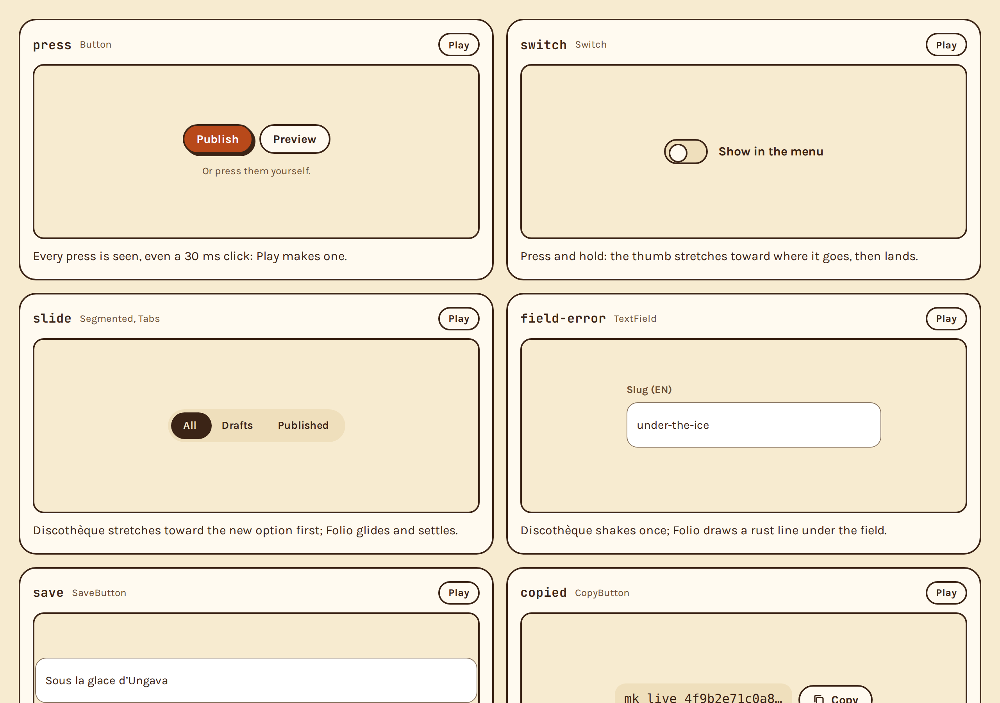
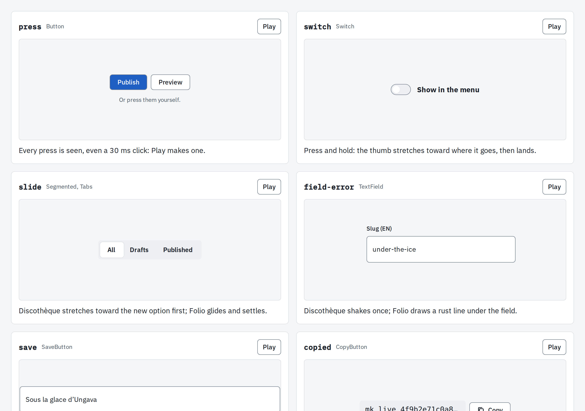
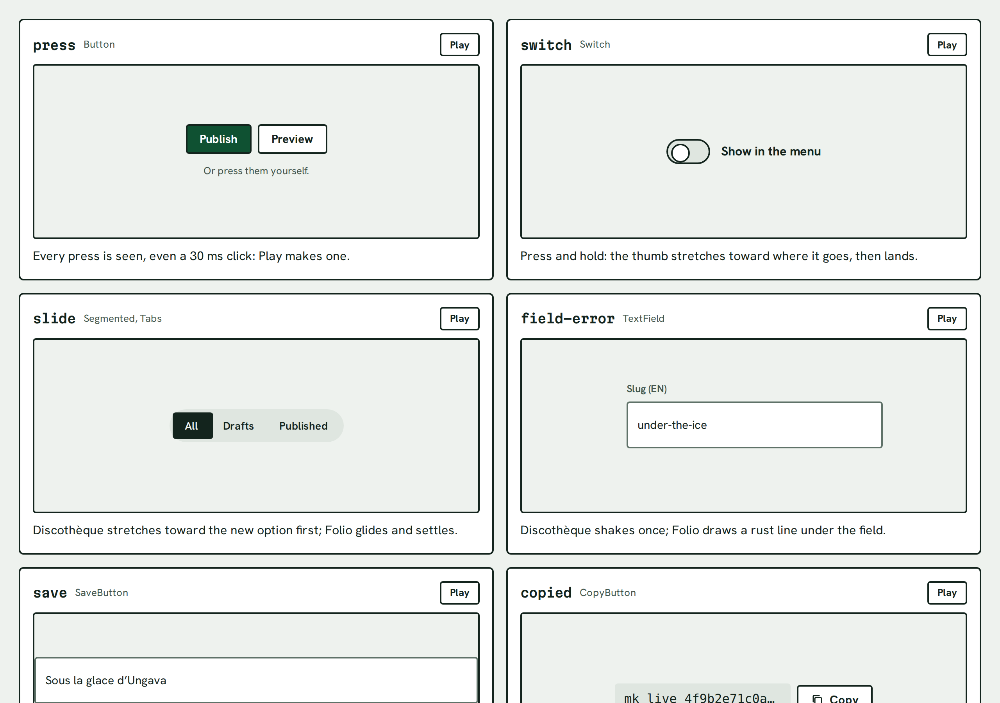
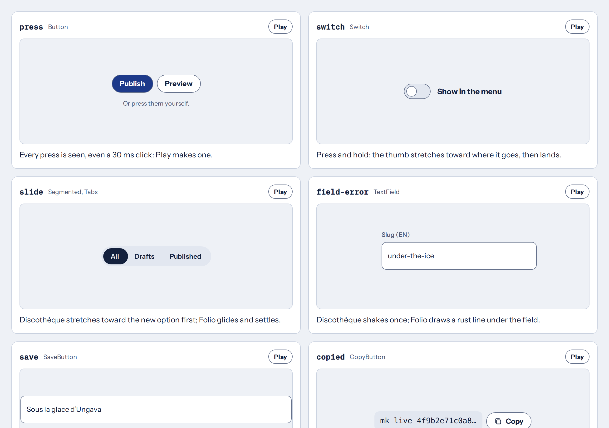

# Trentesix

_Se mettre sur son trente-six_: to put on one's finest. Trentesix is what an app puts on: a
design system in looks. Each look is a package: its colours, fonts and the way it moves, as CSS
variables and CSS moments. They all sit on one core, so component CSS reads one set of variable
names whatever the look. There is no framework and no runtime dependency: plain CSS variables and
CSS, for any page built with a bundler.

| Package                  | What it is                                                                                                                     |
| ------------------------ | ------------------------------------------------------------------------------------------------------------------------------ |
| `@trentesix/core`        | The base every look starts from, the moments, the motion helper, the contrast checker, the stylelint rules and the editor help |
| `@trentesix/discotheque` | The default look: print you can touch. Warm paper, thick ink outlines, hard offset shadows, a serif for display                |
| `@trentesix/folio`       | Calm and conventional: cool greys, 1px borders, soft shadows, one sans-serif                                                   |
| `@trentesix/devis`       | The quote tool's look: a worksite's structure with bank-note green and serif money; a notary's seal                            |
| `@trentesix/relais`      | The email desk's look: postal navy on blue-grey paper, the airmail stripe; a postmark                                          |

Every moment, playing in every look: **[the moments page](https://trentesix.github.io/trentesix/)**.

| Discothèque                                                                                                   | Folio                                                                                               |
| ------------------------------------------------------------------------------------------------------------- | --------------------------------------------------------------------------------------------------- |
|  |    |
| **Devis**                                                                                                     | **Relais**                                                                                          |
|              |  |

## Guides

- [Foundations](packages/core/docs/foundations.md): colour roles, type, spacing, radius, borders, elevation,
  focus, icons and layout, in every look.
- [Motion and moments](packages/core/docs/motion.md): every named motion, its markup, reduced motion and the
  helper.
- [Writing](packages/core/docs/writing.md): voice and tone in English and French.

## Install

An app installs core and the looks it wears:

```sh
pnpm add @trentesix/core @trentesix/devis
```

The stylesheets import each other and their fonts by package name (`@import
'@trentesix/core/base.css'`, `@import '@fontsource/…'`), so they are loaded through a bundler
that resolves `node_modules`: Vite, webpack, Parcel, esbuild or PostCSS with `postcss-import`. A
plain `<link>` to a file in `node_modules` won't find them. The scripts are ES modules and need
Node 20.19 or later.

## Three layers

**Tokens.** Colours, type, spacing, radii, shadows and motion, as CSS variables. Core's
`base.css` sets what every look starts from on `:root`; a look's `look.css` sets its colours and
what differs. Each look's `all.css` loads everything it needs, in order:

```css
@import '@trentesix/devis/all.css';
```

which is the same as:

```css
@import '@trentesix/core/base.css';
@import '@trentesix/devis/look.css';
@import '@trentesix/devis/fonts.css';
@import '@trentesix/core/moments.css';
@import '@trentesix/devis/moments.css';
```

The same values are available to scripts, and as JSON:

```js
import { duration, easing } from '@trentesix/core';
import { look, motion } from '@trentesix/devis';
```

**Moments.** Every named motion (a press, a toast, a seal, a drawer unfolding) as CSS keyed on
`data-moment`, `data-state` and `data-part`. Most of them need no script. Core has them all and
plays them its default way; a look adds what it does differently in its `moments.css`, which loads
after core's.

```html
<button data-moment="press copied" data-state="done">…</button>
```

Component CSS can use the same arrival, leaving and flash: the `trentesix-enter`, `trentesix-leave`
and `trentesix-flash` keyframes, set with `--enter-*`, `--leave-*` and `--flash`, timed with
durations that reduced motion already caps (`--motion-pop`, `--motion-linger` and the rest).

```css
.chip {
  --enter-y: 6px;
  animation: trentesix-enter var(--motion-pop) var(--spring-pop) both;
}
```

**Helper.** A small ES module for the few moments CSS can't do alone: a title flying from a list
into the editor, a counter rolling its digits, press and hold, a toast's timer. It can be
tree-shaken.

```js
import { flight, toastTimer } from '@trentesix/core/motion';
```

## Looks and themes

The default look, Discothèque, is set on `:root` and needs no attribute. Every other look is set
with `data-look` on `<html>`: `data-look="devis"`. A look says how it moves with `--temper`:
`lively` (Discothèque) or `calm` (Folio, Devis, Relais). The calm looks share the calm rules,
which the build puts into each one's `moments.css`, and the helper reads `--temper` to move the
same way.

Each look has a light and a dark theme. Without an attribute the system setting decides;
`data-theme="light"` or `data-theme="dark"` on `<html>` forces one.

A part of a page can wear another look, such as a preview of one look inside another: load that
look's `look.css` and put `data-look` on the element. Its colours, type, shapes and motion tokens
follow inside it, and its theme is the page's unless it has a `data-theme` of its own. Moments
keep the page's look.

A new look is a package with a `tokens.json` (its colours, in the shared names, and what differs),
a `fonts.css` and a `src/moments.css`; the build does the rest.

## Reduced motion

Moments follow the system's reduced-motion setting, and `data-motion="reduce"` or
`data-motion="full"` on `<html>` overrides it. Under reduced motion nothing travels, grows,
bounces or repeats, fades and drawn lines stay short, and timers run as usual. Component CSS can
follow the same rule with `--travel`, `--loop` and `--motion-cap`; see
[docs/motion.md](packages/core/docs/motion.md).

## Linting with stylelint

`@trentesix/core/stylelint` is a stylelint config that keeps an app's CSS on the tokens. Install
stylelint (17 or later) and extend it:

```js
// stylelint.config.js
export default { extends: ['@trentesix/core/stylelint'] };
```

It turns on no style or formatting rules, only these:

- **Raw colours**: hex, named colours (`transparent` and `currentColor` are fine) and colour
  functions (`rgb()`, `hsl()`, `oklch()` and the rest). Use a colour variable.
- **Raw motion** (`trentesix/motion-tokens`): a duration or delay written in `ms` or `s`, or a
  `cubic-bezier()` or `linear()` curve, in `transition` and `animation` and their longhands. `0s`,
  `inherit` and anything inside `var(…)` pass, except an uncapped token as the duration of a
  `trentesix-` keyframe: `trentesix-enter var(--spring-pop-duration)` should be
  `trentesix-enter var(--motion-pop)`, which stays short under reduced motion.
- **Killing motion** (`trentesix/no-motion-kill`): durations above zero and under 10 ms, like
  `animation-duration: 0.01ms`, and, for reduced motion, `animation: none`, `transition: none` or
  `!important` on an animation or transition. These skip moments and fire timers at once; reduce
  motion with `--travel`, `--loop` and `--motion-cap` instead (see
  [docs/motion.md](packages/core/docs/motion.md)).
- **Keyframes that move** (`trentesix/keyframes-travel`): `transform`, `translate`, `scale` or
  `rotate` in `@keyframes` without `var(--travel)` in a `calc()`, so the move would still happen
  under reduced motion. Values that move nothing (`none`, `scale(1)`) pass.

An app that keeps colour values in a token file of its own turns the colour rules off there:

```js
export default {
  extends: ['@trentesix/core/stylelint'],
  overrides: [
    {
      files: ['src/tokens.css'],
      rules: { 'color-no-hex': null, 'color-named': null, 'function-disallowed-list': null },
    },
  ],
};
```

For a real exception, disable one rule for one line and say why:
`/* stylelint-disable-next-line trentesix/keyframes-travel -- a timer, not travel */`.

## Editor help

Core has VS Code custom data, generated from the tokens and the moments: hover a variable to see
what it's for and its value in each look and theme, and get completions for every `--variable`
and for the `data-moment`, `data-state`, `data-part`, `data-look`, `data-theme` and
`data-motion` attributes. Add the files to `.vscode/settings.json`:

```json
{
  "css.customData": ["./node_modules/@trentesix/core/vscode/css-custom-data.json"],
  "html.customData": ["./node_modules/@trentesix/core/vscode/html-custom-data.json"]
}
```

## Design tools

Each look also ships its tokens in the Design Tokens Community Group format (the W3C community
group's [2025.10 spec](https://www.designtokens.org/tr/2025.10/format/)), one file per theme:
`@trentesix/<look>/dtcg/light.tokens.json` and `dark.tokens.json`. Each is whole (the base and
the look) and holds what the CSS declares: colours, spacing, radii, borders, durations, easings,
families, the type scale and shadows, with the usage notes as descriptions and references kept as
aliases (`{color.ink}`). Import one per mode into Figma's variables or Tokens Studio. Springs,
keyword settings and the compatibility variables stay in CSS. They are generated by `pnpm build`
(`scripts/dtcg.mjs`); edit the tokens, not these.

## Building and checking

A pnpm workspace: `packages/core` and one package per look. The CSS and JS of every package are
generated from its `tokens.json`, and so are the contrast tables in
[docs/foundations.md](packages/core/docs/foundations.md) and core's `vscode/` files:

```sh
pnpm build   # writes core/base.css and tokens.*, each look's look.css, moments.css, all.css,
             # tokens.* and dtcg/*, core's vscode/* and the contrast tables
pnpm check   # fails if any of those are out of date, if a colour pair is below its contrast,
             # if the hand-written moments break the stylelint config, or on formatting
pnpm test    # plays every moment in a browser, in every look, with and without reduced motion
             # and in forced colours, and tests the helper, the contrast checker and the
             # stylelint rules
pnpm smoke   # packs every package, installs the tarballs in an empty app and checks every
             # export and every stylesheet import resolves
pnpm site    # builds site/: the moments page with every look's fonts (GitHub Pages)
pnpm screenshots   # photographs it in every look and theme, into media/ for the READMEs
pnpm visual  # photographs it in every look and theme and compares with test/visual/
```

Written by hand: core's `moments.css`, `motion.js` and `src/calm.css` (the calm rules), and each
look's `src/moments.css` and `fonts.css`.

**Releasing.** The five packages share one version. A change users would notice comes with a
changeset (`pnpm changeset`); `pnpm changeset version` bumps the versions, and `pnpm release`
builds, checks, tests, smoke-tests and publishes (with pnpm, which puts the license in each
package). CI (`.github/workflows/ci.yml`) runs the check, the tests, the smoke test and the
visual check on every push and pull request; `.github/workflows/pages.yml` publishes the moments page from main.

**Contrast.** `packages/core/contrast.json` lists the colour pairs that must stay readable, each
with its minimum: 4.5:1 for text, 3:1 for large text and for focus rings and the edges of
controls. The check measures every pair in every look and theme, on the values the generated CSS
gives each variable over core's base, and prints a table of the pairs that fall short.

An app can hold its own colours to the same standard: `@trentesix/core/contrast` exports the
checker's `ratio(fg, bg)` (WCAG contrast, hex or `rgb()`) and `shown(ratio)` (rounded down, as
the tables show it).

**Reduced motion.** `pnpm test` opens `test/fixture/`, a page with one live example of each
moment, in Chromium through `playwright-core`, and plays them all. In each look, with reduced
motion and without, it checks that the page logs no errors, that what each moment leaves on screen
ends visible, that the toast lasts its full time and that `--travel` is 0 only under reduced
motion. If the browser is missing: `pnpm exec playwright-core install chromium`. To look at the
page yourself: `node test/fixture/serve.mjs`.

**Forced colours.** The same page, with Windows' high-contrast mode emulated: the moments that say
something only with a colour (the slide's indicator, a hold, a change-mark, a flash) must still be
seen. See [docs/foundations.md › Forced colours](packages/core/docs/foundations.md#forced-colours).

**Visual regression.** `pnpm visual` builds the site, plays every moment under reduced motion (so
each lands where it ends), photographs the page in every look and theme and compares the pictures
with the approved ones in `test/visual/`. A difference writes the new picture and a diff (changed
pixels in magenta) to `test/visual/results/`, which CI keeps as an artifact. When the change is
meant, `pnpm visual --update` approves it; commit the pictures with the change.

## License

MIT
