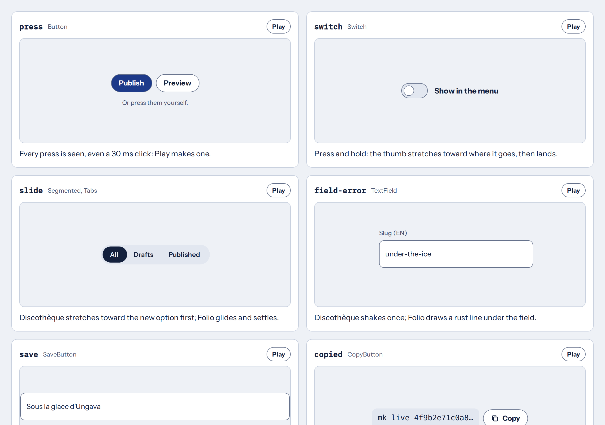
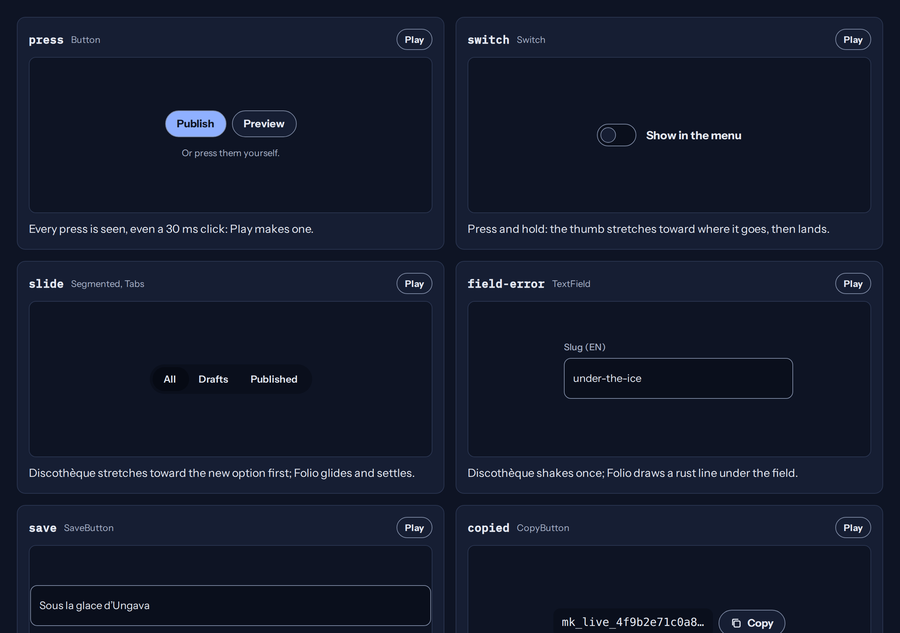

# @trentesix/relais

Relais, the email desk's look: postal navy on blue-grey paper, the airmail stripe; calm, with a postmark.

| Light                                                                                               | Dark                                                                                              |
| --------------------------------------------------------------------------------------------------- | ------------------------------------------------------------------------------------------------- |
|  |  |

Every moment, playing in Relais: [the moments page](https://trentesix.github.io/trentesix/?look=relais).

```sh
pnpm add @trentesix/core @trentesix/relais
```

```css
@import '@trentesix/relais/all.css';
```

Through a bundler (Vite, webpack, Parcel, esbuild, PostCSS with `postcss-import`): the
stylesheets import core and the fonts by package name.

On `<html>`: `data-look="relais"`. Its temper is calm.

| File          | What it is                                                                           |
| ------------- | ------------------------------------------------------------------------------------ |
| `all.css`     | Everything, in order: core's base, this look, its fonts, core's moments, its moments |
| `look.css`    | Its colours and what differs from the base, light and dark                           |
| `fonts.css`   | Its fonts, self-hosted                                                               |
| `moments.css` | Its moments, after `@trentesix/core/moments.css`                                     |
| `tokens.json` | Its tokens; `import { look, motion } from '@trentesix/relais'` for scripts           |

The guides ship with `@trentesix/core` ([foundations](https://github.com/trentesix/trentesix/blob/main/packages/core/docs/foundations.md), [motion](https://github.com/trentesix/trentesix/blob/main/packages/core/docs/motion.md), [writing](https://github.com/trentesix/trentesix/blob/main/packages/core/docs/writing.md)); the whole system is described in the [Trentesix repository](https://github.com/trentesix/trentesix#readme).
